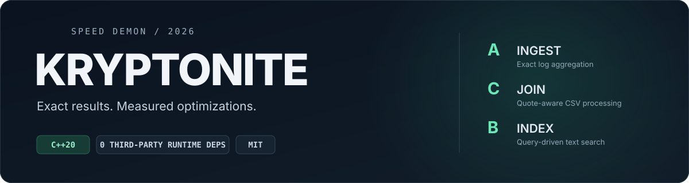

<p align="center">
  
</p>

<p align="center">
  <strong>Exact results. Measured optimizations. Reproducible builds.</strong><br>
  Independent C++20 entries for the Speed Demon 2026 performance championship.
</p>

<p align="center">
  <a href="#the-entry">The entry</a> ·
  <a href="#verification">Verification</a> ·
  <a href="#local-measurements">Measurements</a> ·
  <a href="#build-and-run">Build &amp; run</a> ·
  <a href="#leaderboard-setup">Leaderboard setup</a>
</p>

---

> **All-four optimization trial prepared.** Prior verified source remains preserved.
> Historical best-three overall: **73.343**. Target: **90**, still unmet.
> A compact allocation and C name-local membership gained; the B6 trial was rejected.
> New A/B/C/D candidates pass fresh-seed and offline-image checks; native scoring is next.
> See [STATUS.md](STATUS.md) and [the trial manifest](benchmarks/four-track-portfolio-trial.json).

## The entry

**Kryptonite** implements four exact-output workloads with the C++20 standard
library and POSIX interfaces. Each track is an independent build context, with
all indexing, parsing and aggregation performed from the actual inputs at runtime.

| Track | Workload | Implementation | Required output |
| :--- | :--- | :--- | :--- |
| **A · Ingest** | Aggregate 3.1 million HTTP log lines | [Source](track-a/main.cpp) · [Approach](track-a/README.md) · [Performance log](track-a/PERF.md) | `summary.txt` |
| **C · Join** | Parse and join 3.32 million CSV records | [Source](track-c/main.cpp) · [Approach](track-c/README.md) · [Performance log](track-c/PERF.md) | `aggregates.txt` |
| **B · Index** | Answer 50,000 queries over 250,000 documents | [Source](track-b/main.cpp) · [Approach](track-b/README.md) · [Performance log](track-b/PERF.md) | `results.txt` |
| **D · Traverse** | Exact directed shortest paths for 2,000 queries | [Source](track-d/main.cpp) · [Approach](track-d/README.md) · [Performance log](track-d/PERF.md) | `distances.txt` |

| Language | Runtime dependencies | Submission branch | Licence |
| :--- | :--- | :--- | :--- |
| **C++20** | **0 third-party dependencies** | [`speed-demon`](https://github.com/Avi36005/Speed-demon/tree/speed-demon) | [MIT](LICENSE) |

### Engineering decisions

**A — compact per-hour records.** One AVX2/SWAR parse stores endpoint IDs,
error bits and exact latency escapes. A persistent worker team groups and
selects each hour, releases records, then formats disjoint output slices.
Endpoint equality and nearest-rank percentiles remain exact.

**C — exact parallel CSV.** Record starts follow the frozen grammar. Raw
canonical name bytes are interned in an exact shared table with prefetched
lookups; country bits beside each name credit exact first-set counts. Numeric aggregates
are private, use64-bit arithmetic and integer cents, and merge exactly.

**B — one scan, bounded indexes.** AVX2 tokenization feeds inline exact phrase
checks and ten phased sparse-run/bitmap indexes. Boolean operations preserve
strict LTR order. Per-phase frequencies eliminate guaranteed-empty prefixes
and preserve exact OR revival, reducing unnecessary query work.

**D — exact directed graph search.** Parallel forward/reverse CSR construction
feeds bidirectional Dijkstra. Sparse private distance tables have an exact64-bit side
map, and only a valid frontier bound terminates a search.

## Official live-board measurements

| Track | Machine points | Time | cgroup peak | Real run at `036225c` |
| :--- | ---: | ---: | ---: | :--- |
| A | 79.808946 | 0.026911 s | 25,014,272 B | `run-5f9bb2ac6c4e` |
| B | 65.806136 | 0.321271 s | 46,911,488 B | `run-81df8b60b921` |
| C | 73.983336 | 0.043319 s | 12,263,424 B | `run-5390ab67f3f3` |
| D | 53.924001 | 0.483486 s | 271,896,576 B | `run-7b43f4f31e6e` |

All four tracks are registered. Overall selects the best three. These are
single public-data runs; final holdout and judging remain separate. The C name-local
membership layout improved its actual score and is retained. Small time differences
remain noisy. New A/B experiments are recorded separately until scored.
[Immutable receipt](benchmarks/board/2026-11-02T083443.958935Z.json) ·
[Kryptonite on the board](https://speeddemon.dev/board/#kryptonite-96429f)

## Verification

Evidence is keyed by actual source/build/input hashes and worker options.
Historical manifests certify their recorded source, rather than every later
rewrite. The new all-four trial is pinned in
[its manifest](benchmarks/four-track-portfolio-trial.json). Native scoring will determine selection.

| Check | Current evidence |
| :--- | :--- |
| **Native board** | All four tracks passed build, public-full correctness, timeout and sandbox gates at036225c. |
| **Native development checks** | Exact036225c B/C fixtures, ASan/UBSan and fresh sample42 passed in [native CI](https://github.com/Avi36005/Speed-demon/actions/runs/41413513572); unchanged A/D parent proofs remain in their logs. |
| **Independent full input** | Current A/C/D and proposed B match the untouched full-seed7 oracle; B also passes workers1/12. |
| **Changed B/C paths** | All fixtures pass UBSan with halt-on-error and C++ bounds assertions, including independent OR revival and concurrent country-word boundary cases. |
| **Deterministic B/C output** | Five paired public-full executions and five exact-image sandbox runs retain the published output hash. |
| **Clean B/C packaging** | Offline/no-cache amd64 build, runtime-library inspection, uid65534, read-only root/data, no network, exact output and empty filesystem diffs; fresh full7 also passes. |

Current local compatibility checks use native ARM QEMU emulating x86 Haswell.
They establish semantics and image compatibility. Their elapsed times and
cgroup peaks include emulator costs and cannot replace native Intel T/M.
ASan's local shadow allocator cannot initialize in this QEMU setup; the new
branch uses UBSan/bounds checks, and existing native ASan evidence is retained
for unchanged parent code. Final assembled-head release checks remain scheduled
before freeze.

[Verification report](SUBMISSION_REPORT.md) · [Test coverage](tests/README.md) ·
[Experiment records](benchmarks)

## Local measurements

The following are **historical initial-release development measurements on
ARM64 macOS**, using Apple
Clang 17 with C++20, `-O3`, `-DNDEBUG` and `-pthread`. Time is the mean of the
middle three of five process runs on the public full seed 1 dataset.

| Track | Local elapsed time | Peak process RSS | Formatted code lines |
| :--- | ---: | ---: | ---: |
| **A · Ingest** | **0.250590 s** | 297.1 MiB | 187 |
| **C · Join** | **0.885086 s** | 210.7 MiB | 218 |
| **B · Index** | **2.230760 s** | 497.7 MiB | 350 |

Process RSS includes resident input mappings and is distinct from official
cgroup memory. Code lines were measured locally with the organisers' static
tooling. Each track declares dependency weight **D = 1**, reported by that tooling
as **declared, unverified**. The official live-board measurements above apply
to their recorded commit. Current tuning comparisons are in each PERF.md.

The initial local amd64 runtime images were approximately **30 MB**; the live
board reported approximately **119 MB** images. Each uses an allowlisted,
digest-pinned GCC 15 build stage and Debian 13 runtime. The C++ and GCC support
libraries are linked statically; final runtime library checks pass.

Raw timings, source digests, commands, rejected experiments and measurement
methods are retained in [benchmarks](benchmarks) and the per-track performance logs.

## Build and run

### Build an independent track

Prepare every exact base-image digest listed in the track's Dockerfile before
the offline build. Build from that track folder alone:

```sh
docker build --platform linux/amd64 --network=none -t kryptonite-a track-a
docker build --platform linux/amd64 --network=none -t kryptonite-c track-c
docker build --platform linux/amd64 --network=none -t kryptonite-b track-b
docker build --platform linux/amd64 --network=none -t kryptonite-d track-d
```

### Run Track A

Place the official `requests.log` in `data/track-a/full-seed1/`. The public
datasets and checksums are linked from the [official board](https://speeddemon.dev/board/).

```sh
mkdir -p .out/a
chmod 777 .out/a

docker run --rm --platform linux/amd64 \
  --network=none --read-only \
  --memory=8g --memory-swap=8g --pids-limit=512 \
  --cap-drop=ALL --security-opt=no-new-privileges \
  --tmpfs /tmp:rw,size=1g,exec --user 65534:65534 \
  -v "$PWD/data/track-a/full-seed1:/data:ro" \
  -v "$PWD/.out/a:/out:rw" \
  kryptonite-a
```

The result is `.out/a/summary.txt`. Track C reads `records.csv` and `regions.csv`;
Track B reads `docs.txt` and `queries.txt`. Each writes the output named in the
track table. Input is read-only under `/data`; `/out` holds exactly one output file.

### Reproduce development checks

The development runners use the materials workspace layout: this repository at
`submission/`, official tools at `../official/speed-demon-2026/`, and public
datasets at `../data/track-*/`. Submitted track images need no parent files.

```sh
python3.13 tools/dev.py a --data ../data/track-a/full-seed1 --label full-seed1 --repeat 5
python3.13 tools/dev.py c --data ../data/track-c/full-seed1 --label full-seed1 --repeat 5
python3.13 tools/dev.py b --data ../data/track-b/full-seed1 --label full-seed1 --repeat 5

python3.13 tools/suite.py a --fixtures --scale sample --seeds 2 3 42
python3.13 tools/suite.py c --fixtures --scale sample --seeds 2 3 42
python3.13 tools/suite.py b --fixtures --scale sample --seeds 2 3 42
```

Python **3.11+** and a C++20 compiler are required for native development checks.
`tools/container_check.py` reproduces the local emulated container checks.
Correctness comparison and oracle execution are outside the candidate timing
interval; repeated timed runs include candidate startup, processing and output.

## Leaderboard setup

The source is already pushed to
**[Avi36005/Speed-demon](https://github.com/Avi36005/Speed-demon)**.
A/B/C/D registration and repository access are confirmed by the scored board runs.
The setup procedure, including changes to entered tracks, is documented in the
[official kickstart](https://speeddemon.dev/kickstart/):

1. Every team member completes [individual registration](https://tally.so/r/q4redG).
2. Grant the [Speed Demon Board App](https://github.com/apps/speed-demon-board)
   access to `Avi36005/Speed-demon`.
3. Submit the [team form](https://tally.so/r/Ar7g9z): **Kryptonite**, **C++**,
   tracks **A + B + C + D**, this repository URL, and the real contact/member details.
4. Check the [live board](https://speeddemon.dev/board/) after registry and queue
   processing. Save actual run IDs and results in the relevant performance logs.

**[Copy-ready submission details](SUBMISSION_DETAILS.txt)** ·
**[Complete submission checklist](SUBMISSION_CHECKLIST.md)**

The repo can stay private before freeze when the Board App has access. Confirm
the final branch commit was observed before **2 November 2026, 20:30 IST**.
Make the recorded source public under MIT by **21:30 IST** that day, within the
published one-hour window. All four tracks are confirmed registered in the latest saved receipt.

## Repository map

```text
track-a/                    Ingest: source, Dockerfile, metadata, README, PERF
track-c/                    Join: source, Dockerfile, metadata, README, PERF
track-b/                    Index: source, Dockerfile, metadata, README, PERF
track-d/                    Traverse: verified bidirectional search; registration pending
benchmarks/                 Recorded experiments, hashes and verification evidence
tests/                      Development fixture generation and coverage notes
tools/                      Differential runners, profiling and release checks
docs/assets/                Repository presentation assets
SUBMISSION_REPORT.md        Technical evidence and reproduction commands
SUBMISSION_CHECKLIST.md     Registration, app access and deadline checklist
SUBMISSION_DETAILS.txt      Values to copy into the team submission form
STATUS.md                   Current state and continuation notes
```

Generated datasets, development binaries and large local artifacts stay in
gitignored directories outside the track build contexts. The original verified
development history is preserved; later file-import commits are documented in
[the publication receipt](benchmarks/publication.json).

## Licence

Licensed under the **[MIT licence](LICENSE)**. The original starter copyright
notices are retained. See the track READMEs for assumptions, limitations and the
next experiments worth testing.
